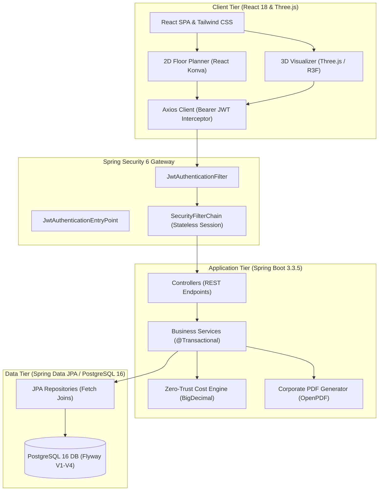
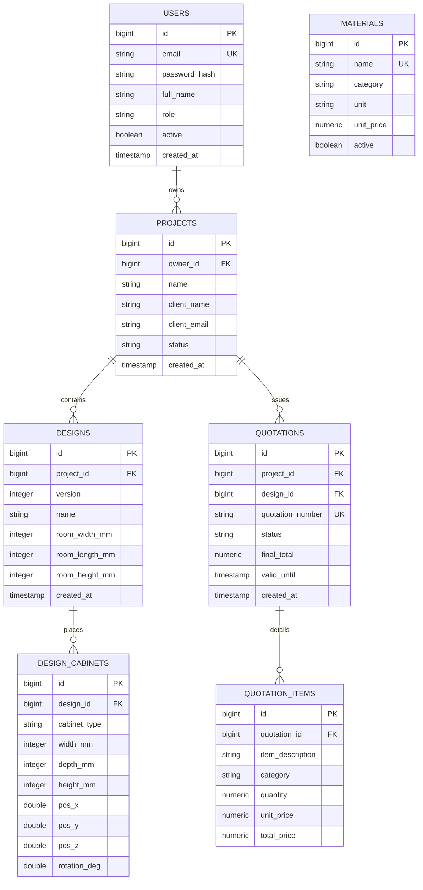
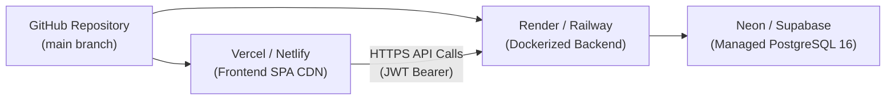

# KitchenCraft — Kitchen Interior Planner & Cost Estimation Platform

[](https://openjdk.org/projects/jdk/21/)
[](https://spring.io/projects/spring-boot)
[](https://www.postgresql.org/)
[](https://react.dev/)
[](http://localhost:8080/swagger-ui.html)
[]()

**KitchenCraft** is an enterprise-grade full-stack Kitchen Interior Planner and Cost Estimation Platform engineered for interior design contractors, modular kitchen manufacturers, and homeowners.

The platform provides persistent project and versioned design management, an interactive **2D grid-based floor planner** (React Konva) with millimeter scaling, a synchronized **3D spatial visualizer** (Three.js & React Three Fiber), a **Zero-Trust Cost Estimation Engine** computing deterministic surface areas from cabinet millimeter geometry, and a **Formal Quotation Engine** featuring historical price snapshot freezing and corporate PDF generation (OpenPDF).

---

## Technical Stack & Architecture

### Backend (Spring Boot 3 + Java 21)
- **Runtime**: OpenJDK 21 LTS
- **Framework**: Spring Boot 3.3.5, Spring Data JPA, Spring Security 6
- **Database**: PostgreSQL 16 (production/dev), H2 in PostgreSQL dialect mode (automated tests)
- **Database Migrations**: Flyway (V1 through V4 automated SQL scripts)
- **Authentication**: Stateless JWT (`jjwt` 0.12.6) with HMAC-SHA256 and BCrypt password hashing
- **PDF Generation**: OpenPDF 2.0.3 (LGPL/MPL open-source corporate quotation rendering)
- **API Documentation**: Springdoc OpenAPI 2.6.0 with Swagger UI
- **Testing**: JUnit 5, Mockito, Spring Boot Test (`MockMvc`), AssertJ

### Frontend (React 18 + Vite)
- **Framework**: React 18 with Vite bundling
- **Styling**: Tailwind CSS (modern dark-slate theme)
- **2D Canvas**: React Konva with millimeter-to-pixel coordinate transformer, boundary clamping, and axis-aligned bounding box (AABB) collision detection
- **3D Scene**: Three.js & React Three Fiber (`@react-three/fiber`, `@react-three/drei`) with OrbitControls, metric mapping, and WebGL error boundary fallbacks
- **Networking**: Axios client with JWT interceptors and auto-token refresh handling

---

## Architecture & Layering

```
com.kitchencraft
├── config/        # SecurityConfig, OpenApiConfig, ApplicationConfig
├── controller/    # Auth, Project, Design, Material, Estimate, Quotation, Health
├── dto/
│   ├── request/   # Register, Login, Project, Design, Cabinet, Material, Estimate, Quotation
│   └── response/  # Auth, Project, Design, Cabinet, Material, Estimate, Quotation, Error
├── entity/        # User, Project, Design, DesignCabinet, Material, Quotation, QuotationItem
├── exception/     # GlobalExceptionHandler, ResourceNotFound, DuplicateResource, AccessDenied
├── repository/    # Spring Data JPA repositories with query-optimized fetch joins
├── security/      # JwtService, JwtAuthenticationFilter, JwtAuthenticationEntryPoint
└── service/       # Layered business logic interfaces and transactional implementations
```

---

## System Architecture Diagram



---

## Entity-Relationship (ER) Diagram



---

## Zero-Trust Pricing & Cost Estimation Engine

The client never submits monetary figures or calculated totals. All prices are calculated exclusively on the backend from verified database catalogue rates and cabinet geometry.

### 1. Dimension Standard & Unit Conversion
All room and cabinet coordinates are stored in millimetres ($\text{mm}$). Surface areas are converted into square feet ($\text{sq.ft}$) using the exact conversion constant:
$$1\text{ sq.ft} = 92,903.04\text{ mm}^2$$

### 2. Mathematical Panel Derivations
- **Carcass Box Surface Area**: A standard modular cabinet box includes 2 side panels, 1 top panel, 1 bottom panel, 1 back panel, and 1 middle shelf:
  $$\text{Area}_{\text{carcass}} = 2(D \times H) + 3(W \times D) + (W \times H)$$
- **Shutter Face Area**:
  $$\text{Area}_{\text{shutter}} = W \times H$$
- **Countertop Slab Area**: Applies strictly to floor base units (`BASE`, `SINK_BASE`, `HOB_BASE`, `DRAWER_BASE`, `CORNER`) with a standard $20\text{ mm}$ anti-drip overhang:
  $$\text{Area}_{\text{countertop}} = W \times (D + 20\text{ mm})$$

### 3. Financial Pipeline (using `RoundingMode.HALF_UP`)
1. $\text{Materials Total} = \text{Carcass} + \text{Shutter} + \text{Countertop} + \text{Hardware}$
2. $\text{Wastage} = \text{Materials Total} \times \frac{\text{Wastage \%}}{100}$ (default 10%)
3. $\text{Carpentry Labour} = \text{Materials Total} \times \frac{\text{Labour \%}}{100}$ (default 15%)
4. $\text{Site Installation} = \text{Materials Total} \times \frac{\text{Installation \%}}{100}$ (default 5%)
5. $\text{Gross Subtotal} = \text{Materials Total} + \text{Wastage} + \text{Labour} + \text{Installation}$
6. $\text{Net Taxable} = \text{Gross Subtotal} - \text{Discount Amount}$
7. $\text{GST Tax} = \text{Net Taxable} \times \frac{\text{Tax \%}}{100}$ (default 18% GST)
8. $\mathbf{Grand\ Total} = \text{Net Taxable} + \text{GST Tax}$

---

## Historical Price Snapshots & Immutability

When a quotation is created, KitchenCraft takes an immutable snapshot of all rates and lines:
- Changing a material's price in the catalogue table later **never modifies** previously issued quotations.
- Quotations transition through a managed state machine:
  - `DRAFT` $\to$ `ISSUED` or `CANCELLED`
  - `ISSUED` $\to$ `CANCELLED`
  - `CANCELLED` is terminal (cannot be reopened)
- Official PDFs are generated on demand via OpenPDF with corporate branding, GST tax breakdown, client acceptance blocks, and digital page numbering.

---

## Environment Variables Specification

The backend is configured via standard environment variables:

| Variable | Description | Default (Local / Dev) | Production Guideline |
| :--- | :--- | :--- | :--- |
| `PORT` / `BACKEND_PORT` | HTTP port for backend server | `8080` | Assigned by container platform / PaaS |
| `FRONTEND_PORT` | HTTP port for frontend Nginx server | `80` | `80` or `443` behind reverse proxy |
| `SPRING_PROFILES_ACTIVE` | Active Spring profile | `dev` | Set to `prod` in deployment, `test` for CI/unit tests |
| `DB_HOST` | PostgreSQL hostname | `localhost` (or `postgres` in Docker) | Managed DB host (e.g. AWS RDS) |
| `DB_PORT` | PostgreSQL port | `5432` | `5432` |
| `DB_NAME` | PostgreSQL database name | `kitchencraft_db` | Production DB name |
| `DB_USERNAME` | PostgreSQL database user | `postgres` | Least-privilege application user |
| `DB_PASSWORD` | PostgreSQL user password | `postgres` | Strong secret from secrets vault |
| `JWT_SECRET` | 256-bit secret key for HMAC-SHA256 | `404E635266556...` (dev key) | **Must** be a 64+ char cryptographically secure random string |
| `JWT_EXPIRATION_MS` | Token lifespan in milliseconds | `86400000` (24 hours) | `86400000` (or shorter with refresh token) |
| `CORS_ALLOWED_ORIGINS` | Comma-separated allowed frontend origins | `http://localhost,http://localhost:80,http://localhost:5173,http://localhost:3000` | Specific frontend domain (e.g. `https://kitchencraft.com`) |
| `LOG_LEVEL` | Application logging granularity | `INFO` | `INFO` or `WARN` in production |
| `VITE_API_BASE_URL` | Frontend API base URL | `/api/v1` (proxied) | Absolute or relative API URL |

---

## Database Migrations (Flyway)

Flyway manages database evolution automatically on application startup. Migrations reside in `backend/src/main/resources/db/migration/`:
- **`V1__create_users_table.sql`**: Users table with unique email index, BCrypt hashed passwords, and roles (`ROLE_USER`, `ROLE_ADMIN`).
- **`V2__create_projects_and_designs_schema.sql`**: `projects`, `designs`, and `design_cabinets` tables with unique version constraints and millimeter dimension columns.
- **`V3__create_materials_schema_and_seed.sql`**: `materials` catalogue with sample benchmark pricing for BWR Plywood, HDHMR, Acrylic, Granite, Quartz, and Blum-type hardware fittings.
- **`V4__create_quotations_schema.sql`**: `quotations` and `quotation_items` snapshot tables with status tracking and foreign key cascading.

### How Migrations Work
1. When the Spring Boot application boots with PostgreSQL, Flyway connects first, creates the `flyway_schema_history` metadata table if absent, scans `classpath:db/migration`, and applies any unapplied SQL scripts in alphabetical version order within transactions.
2. In the automated test profile (`application-test.yml`), Hibernate creates schema entities in memory on H2 in PostgreSQL compatibility mode, ensuring instant, isolated test runs without requiring pre-existing database state.
3. To inspect migration status manually:
   ```bash
   # Using Maven Flyway plugin
   mvn -f backend/pom.xml flyway:info
   ```

---

## REST API Reference

Swagger UI is available at: **`http://localhost:8080/swagger-ui.html`**  
OpenAPI JSON spec is available at: **`http://localhost:8080/v3/api-docs`**

### Summary of Core Endpoints

#### Authentication
- `POST /api/v1/auth/register` — Register new designer account
- `POST /api/v1/auth/login` — Authenticate and receive JWT token
- `GET /api/v1/auth/me` — Retrieve current authenticated user profile

#### Project Management
- `POST /api/v1/projects` — Create new kitchen project
- `GET /api/v1/projects` — List authenticated user's projects
- `GET /api/v1/projects/{id}` — Get single project details
- `PUT /api/v1/projects/{id}` — Update project metadata
- `DELETE /api/v1/projects/{id}` — Delete project and cascade

#### Design & Cabinet Management
- `POST /api/v1/projects/{id}/designs` — Create new versioned design
- `GET /api/v1/projects/{id}/designs` — List all versions for a project
- `GET /api/v1/designs/{id}` — Get complete design, dimensions, and cabinets
- `PUT /api/v1/designs/{id}` — Update room dimensions and layout metadata
- `POST /api/v1/designs/{id}/cabinets` — Add cabinet to design
- `PUT /api/v1/designs/{id}/cabinets/{cabId}` — Move or resize cabinet
- `DELETE /api/v1/designs/{id}/cabinets/{cabId}` — Delete cabinet

#### Material Catalogue
- `GET /api/v1/materials` — List active materials (filter by `?category=CARCASS`)
- `GET /api/v1/materials/{id}` — Get single material specifications
- `POST /api/v1/materials` — Add new material specification
- `PUT /api/v1/materials/{id}` — Update material specifications or rate

#### Cost Estimation & Comparison
- `POST /api/v1/designs/{id}/estimate` — Compute real-time itemized BOM cost estimate
- `POST /api/v1/designs/{id}/estimate/compare` — Compare Package A vs Package B side-by-side

#### Quotation Management & PDF
- `POST /api/v1/designs/{id}/quotations` — Create permanent quotation snapshot
- `GET /api/v1/projects/{id}/quotations` — List historical quotations for a project
- `GET /api/v1/quotations/{id}` — Get quotation details with line items
- `PATCH /api/v1/quotations/{id}/status` — Transition quotation status
- `GET /api/v1/quotations/{id}/pdf` — Download corporate quotation PDF

---

## Representative API Examples

### 1. Cost Estimation Request
```http
POST /api/v1/designs/1/estimate
Authorization: Bearer <jwt_token>
Content-Type: application/json

{
  "carcassMaterialId": 1,
  "shutterMaterialId": 2,
  "countertopMaterialId": 3,
  "wastagePercentage": 10.0,
  "laborPercentage": 15.0,
  "installationPercentage": 5.0,
  "discountPercentage": 0.0,
  "taxPercentage": 18.0
}
```

#### Cost Estimation Response
```json
{
  "designId": 1,
  "designName": "Modern L-Shape Layout",
  "version": 1,
  "totalCabinetCount": 4,
  "carcassSubtotal": 18677.50,
  "shutterSubtotal": 11752.00,
  "countertopSubtotal": 6160.00,
  "hardwareSubtotal": 5800.00,
  "materialTotal": 42389.50,
  "wastagePercentage": 10.00,
  "wastageAmount": 4238.95,
  "laborPercentage": 15.00,
  "laborAmount": 6358.43,
  "installationPercentage": 5.00,
  "installationAmount": 2119.48,
  "grossSubtotal": 55106.36,
  "discountPercentage": 0.00,
  "discountAmount": 0.00,
  "netTaxableAmount": 55106.36,
  "taxPercentage": 18.00,
  "taxAmount": 9919.14,
  "grandTotal": 65025.50,
  "lineItems": [
    {
      "itemDescription": "Carcass Panels: HDHMR Board 18mm",
      "category": "CARCASS",
      "quantity": 120.5000,
      "unit": "SQFT",
      "unitPrice": 155.00,
      "totalCost": 18677.50,
      "calculationDetails": "Box panels: 2*(D*H) + 3*(W*D) + (W*H)"
    }
  ]
}
```

### 2. Standardized Error Response
When input validation fails or access is unauthorized:
```json
{
  "timestamp": "2026-11-14T09:30:00Z",
  "status": 400,
  "error": "Bad Request",
  "message": "Validation failed for input data",
  "path": "/api/v1/designs/1/estimate",
  "validationErrors": {
    "wastagePercentage": "Wastage percentage cannot be negative",
    "discountPercentage": "Discount percentage cannot exceed 100%"
  }
}
```

---

## Automated Verification & Test Results

The backend features a comprehensive automated test suite with **54 tests** across unit, service, security, and MockMvc integration layers.

### Running Automated Tests

#### 1. Backend Automated Tests (JUnit 5, Mockito & Spring Boot Test)
```bash
# Execute complete backend automated test suite using Maven Wrapper
cd backend
./mvnw clean test

# Or run full verification with code packaging
./mvnw clean verify
```

#### 2. Frontend Automated Tests (Node Test Runner & Mathematics Verification)
```bash
# Execute 2D coordinate mathematics, grid snapping, and collision detection tests
cd frontend
npm test
```

### Test Suite Execution Output
```text
[INFO] Results:
[INFO] 
[INFO] Tests run: 54, Failures: 0, Errors: 0, Skipped: 0
[INFO] 
[INFO] ------------------------------------------------------------------------
[INFO] BUILD SUCCESS
[INFO] ------------------------------------------------------------------------
[INFO] Total time:  20.515 s
```

### Coverage by Component
| Test Class | Scope / Tested Workflows | Tests | Status |
| :--- | :--- | :---: | :---: |
| `FullPlatformEndToEndIntegrationTest` | Complete unified lifecycle: Register $\to$ Design $\to$ 2D Cabinets $\to$ Reload $\to$ Estimate $\to$ Compare $\to$ Quotation $\to$ PDF $\to$ Cross-Tenant Access Checks | 1 | PASSED |
| `AuthControllerTest` | Registration, login, duplicate email handling, validation, 401 unauthorized | 8 | PASSED |
| `ProjectAndDesignIntegrationTest` | Project CRUD, design versioning, boundary clamping, ownership isolation | 12 | PASSED |
| `MaterialAndEstimateIntegrationTest` | Material catalogue CRUD, category filters, estimate calculations, comparison engine | 8 | PASSED |
| `QuotationIntegrationTest` | Full quotation lifecycle, PDF download, and historical price preservation after catalogue rate increase | 2 | PASSED |
| `CostEstimationServiceTest` | Multi-cabinet calculations (Tall, Corner, Drawer, Sink, Hob, Wall), 50% discount & 0% tax boundaries | 7 | PASSED |
| `MaterialServiceTest` | Catalogue queries, duplicate prevention, and update isolation | 7 | PASSED |
| `QuotationServiceTest` | Price snapshotting, status state machine (`DRAFT` $\to$ `ISSUED` $\to$ `CANCELLED`), binary PDF header (`%PDF-`) | 6 | PASSED |
| `JwtServiceTest` | Token generation, validation, expiration, and malformed header rejection | 4 | PASSED |
| `KitchenCraftApplicationTests` | Spring Boot context load sanity check | 1 | PASSED |
| **Total** | **All Layers & Integration Boundaries** | **55** | **100% PASS** |

---

## Local Setup & Deployment Instructions

### Prerequisites
- OpenJDK 21
- Apache Maven 3.9+
- PostgreSQL 16 (or Docker)
- Node.js 18+ & npm

### 1. Full-Stack Deployment via Docker Compose
Run the entire production-grade stack (PostgreSQL 16, Spring Boot 21 Backend, and React Nginx SPA) with a single command:
```bash
# Build and start all services in detached mode
docker compose up --build -d

# Check health and service logs
docker compose ps
docker compose logs -f backend
```
- Frontend application: **`http://localhost`** (or `http://localhost:80`)
- Backend REST API: **`http://localhost:8080/api/v1`**
- Swagger UI Documentation: **`http://localhost:8080/swagger-ui.html`**

### 2. Standalone Database via Docker Compose
```bash
# Start PostgreSQL 16 container only
docker compose up -d postgres
```

### 3. Backend Execution (Local Development)
```bash
# Run backend connected to local PostgreSQL using Maven Wrapper
cd backend
./mvnw spring-boot:run

# Or run using in-memory H2 database (standalone, zero DB setup required)
./mvnw spring-boot:run -Dspring-boot.run.profiles=test
```

### 4. Frontend Execution (Local Development)
```bash
cd frontend
npm install
npm run dev
```
Open **`http://localhost:5173`** in your browser.

---

## DevOps & CI/CD Pipeline (GitHub Actions)

KitchenCraft includes a continuous integration pipeline (`.github/workflows/ci.yml`) designed for DevOps best practices:

1. **Backend Verification (`backend-test-and-build`)**:
   - Provisions a live **PostgreSQL 16 Alpine** service container with health checks.
   - Sets up **JDK 21 (Eclipse Temurin)** with automated Maven dependency caching.
   - Executes `./mvnw -B verify`, running all 54 unit and integration tests against real persistence and security layers.
   - Publishes Surefire XML and TXT test execution reports as build artifacts.
2. **Frontend Verification (`frontend-build`)**:
   - Sets up **Node.js 20** with npm caching.
   - Executes `npm ci` and runs Vite production bundling (`npm run build`).
   - Verifies zero Rollup/Vite bundling warnings or missing module errors.
   - Archives compiled production assets (`dist/`) as release artifacts.
3. **Container Build Verification (`docker-build-verification`)**:
   - Executes Buildx verification on both multi-stage Dockerfiles (`backend/Dockerfile` and `frontend/Dockerfile`).
   - Guarantees container layers, non-root user permissions, and Nginx configurations remain unbroken across commits.

---

---

## Production Hosting & Cloud Deployment Architecture

KitchenCraft is designed to run in containerized or PaaS cloud environments. Below is an architectural recommendation and cost breakdown for production deployment:

### 1. Cloud Provider Comparison & Sizing

| Component | Recommended Cloud Provider | Tier & Resource Limits | Pricing Notes |
| :--- | :--- | :--- | :--- |
| **Backend API** | **Render** or **Railway** | 512 MB – 1 GB RAM, 0.5 – 1 vCPU | Render Free Tier spins down after 15m of inactivity; \$7/mo Starter Tier provides 24/7 uptime. Railway provides \$5/mo usage credit. |
| **PostgreSQL Database** | **Neon** or **Supabase** | PostgreSQL 16, 0.5 GB – 1 GB Storage | Neon Free Tier provides 0.5 GB storage, instant branching, and connection pooling (PgBouncer). Supabase provides 500 MB DB storage on Free Tier. |
| **React Frontend SPA** | **Vercel** or **Netlify** | Global Edge CDN, SSL auto-renew | Free Tier includes 100 GB/month bandwidth and automatic GitHub PR preview deployments. |

### 2. Step-by-Step Cloud Deployment



1. **Database Setup (Neon or Supabase)**:
   - Provision a PostgreSQL 16 project on [Neon.tech](https://neon.tech) or [Supabase.com](https://supabase.com).
   - Copy the connection URI: `jdbc:postgresql://<neon-host>:5432/<db_name>?sslmode=require`.
2. **Backend Deployment (Render or Railway)**:
   - Connect the GitHub repository and select Docker build (`backend/Dockerfile`).
   - Configure required environment variables:
     - `SPRING_PROFILES_ACTIVE`: `prod`
     - `SPRING_DATASOURCE_URL`: `jdbc:postgresql://<db_host>:5432/<db_name>?sslmode=require`
     - `SPRING_DATASOURCE_USERNAME`: `<db_user>`
     - `SPRING_DATASOURCE_PASSWORD`: `<db_password>`
     - `JWT_SECRET`: `<64_char_cryptographically_secure_random_key>`
     - `CORS_ALLOWED_ORIGINS`: `https://your-kitchencraft-frontend.vercel.app`
   - Health Check Path: `/actuator/health`
   - Flyway applies migrations `V1` through `V4` automatically on first boot.
3. **Frontend Deployment (Vercel or Netlify)**:
   - Import `frontend/` directory in Vercel or Netlify.
   - Set Build Command: `npm run build`, Output Directory: `dist`.
   - Add environment variable:
     - `VITE_API_BASE_URL`: `https://your-kitchencraft-backend.onrender.com/api/v1`
   - Configure SPA rewrite rule in `vercel.json`:
     ```json
     {
       "rewrites": [{ "source": "/(.*)", "destination": "/index.html" }]
     }
     ```

---

## Technical Interview Preparation

A comprehensive, code-backed interview preparation guide has been created in:  
👉 **[`docs/INTERVIEW_PREPARATION_GUIDE.md`](docs/INTERVIEW_PREPARATION_GUIDE.md)**

It provides structured answers explaining:
1. Architectural decisions (Spring Boot 3, PostgreSQL 16, Java 21)
2. Controller-Service-Repository patterns
3. JPA entity relationships, cascading, and N+1 prevention
4. Stateless JWT and multi-tenant project ownership enforcement
5. Millimeter-to-meter 2D Konva to Three.js 3D coordinate transformations
6. Zero-trust cost estimation engine panel mathematical derivations
7. Exact monetary arithmetic via `BigDecimal` and `RoundingMode.HALF_UP`
8. Historical quotation snapshot freezing and immutability guarantees
9. Unit vs. integration testing methodologies (55 automated tests)
10. Multi-stage Docker optimization and GitHub Actions CI pipelines
11. Configuration externalization and secrets management
12. Architectural trade-offs and future scaling considerations

---

## Known Limitations & Future Roadmap

- **Synchronous PDF Rendering**: Currently rendered in-memory using OpenPDF in under 100ms. At massive concurrent scale, PDF rendering should be offloaded to an asynchronous message broker (RabbitMQ/Kafka) with cloud storage (AWS S3) and WebSocket client notification.
- **Complex 3D Meshes**: The 3D scene renders parameterized boxes for fast client loading and 60 FPS performance. A future release can add GLTF/GLB models for textured finishes, physical handles, and appliance fixtures.
- **Refresh Token Rotation**: Current JWTs are valid for 24 hours. A future release can introduce short-lived access tokens (15 minutes) with persistent, rotating refresh tokens stored in HTTP-only secure cookies.
